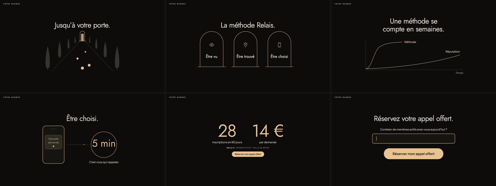
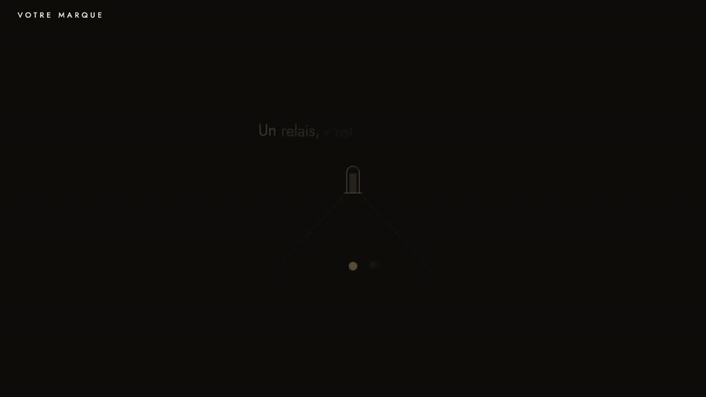
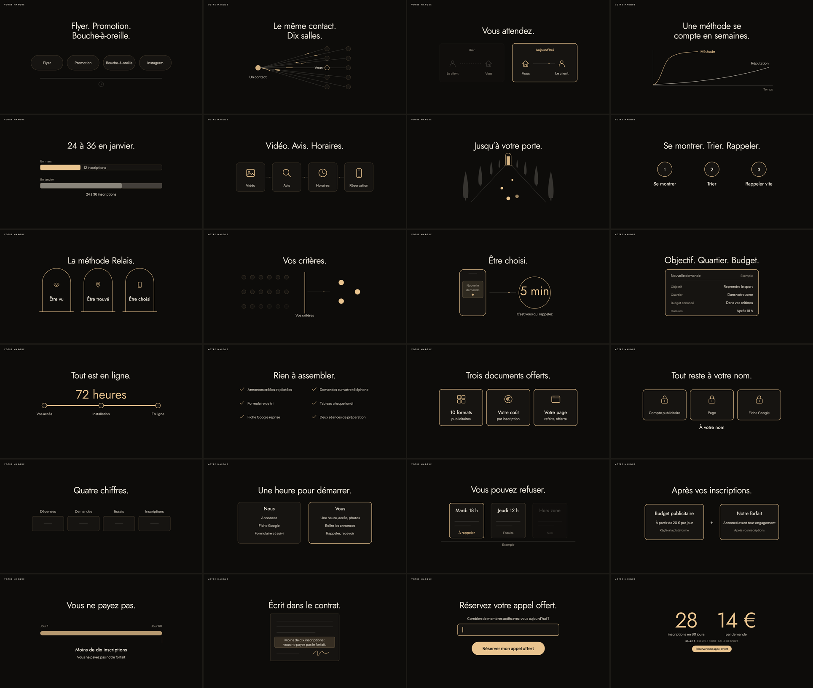

<div align="center">


# Autonomous VSL Script

### Your sales video, written and staged before you press record.

A complete video sales letter on Alex Hormozi's five-part structure.<br>
One HTML file to read from, film and present,<br>
with animated diagrams for everything words explain badly.

**[Install the skill](#install)** · **[Read the playbook](SKILL.md)** · **[See the 23 diagrams](references/05-animations.md)**



<sub>Claude Code + Codex · 5-part framework · copy frameworks and blocking checks · teleprompter, screen and presenter modes · 23 animated diagrams · one file, works offline · MIT</sub>

<br><br>

<a href="https://bizos.cc"></a>

<br><br>

<a href="https://x.com/gauthierthiry"></a>
<a href="https://youtube.com/@gquthier"></a>

</div>

---

## The script and the screen, built as one thing.

Most sales videos get written in a document, then squeezed into slides, then read badly from a second screen. The argument drifts, the proof goes vague, and the slides fight the speaker.

This skill gives a coding agent the whole path, from research to a deck you can film. One script drives everything: what you read, what viewers see, the notes, and the printable version.

- **A structure that cannot drift.** Intro, old way against new way, FAQ loops, small call to action, proof. The compiler assembles the parts itself and refuses a deck that skips one.
- **Proof that cannot be invented.** A figure only reaches the screen if it is declared with its source, and every result names its sector.
- **Copy that has to earn its place.** Awareness, sophistication, the value equation, verbatim research, a named mechanism, and a review pass. The build rejects hype, walls of text and machine-sounding prose.
- **A screen you can film.** One idea per slide, one accent color, a toolbar that disappears when the mouse stops.
- **Diagrams that explain.** 23 animated SVG diagrams for comparisons, journeys, offers, prices and guarantees, all driven by a line of data.
- **Yours in eight colors.** Change the palette and the logo. The typography, spacing and motion stay exactly as designed.

The [starter deck](assets/demo/votre-marque-vsl.html) is entirely fictional: brand, sector, quotes and figures are invented to show the format. Download it and open it in a browser.

## What you get

| Deliverable | Purpose |
| --- | --- |
| Single-file HTML deck | Read it, film it or present it. Fonts and data embedded, no network needed |
| Reading mode | The full script, word by word, with animated keywords |
| Screen mode | The big line and the diagram your viewers see |
| Presenter window | Script, next line and notes, synced with the main window |
| `script.html`, `.md`, `.txt` | Printable script, with a spoken-only view |
| Frozen strategy brief | Hook, big idea, mechanism, offer, allowed proof and banned words |
| Verification report | Every slide tested in three viewports and two modes, with captures |

## Install

**Claude Code** — personal skill:

```bash
git clone https://github.com/gquthier/autonomous-vsl-script.git \
  ~/.claude/skills/vsl-script
```

**Codex** — personal skill:

```bash
git clone https://github.com/gquthier/autonomous-vsl-script.git \
  ~/.codex/skills/vsl-script
```

Start a new agent session if your runtime has already loaded its skill list. Then ask:

> Use the vsl-script skill to write the VSL for my offer. The research and testimonials are in this folder. My colors are navy and mint. Build the deck and show me the captures.

Or:

> Écris ma VSL avec le skill vsl-script. L'offre et les preuves sont dans ce dossier, le format long, en vouvoiement. Construis la présentation et vérifie-la.

## Quickstart

Try the starter without an agent. You need **Python 3.9+**, and **Node.js 18+ with Chrome** for the browser check.

```bash
cp -R ~/.claude/skills/vsl-script/template ./my-vsl
cd my-vsl
python3 build.py
open dist/votre-marque-vsl.html   # or open it in any browser
```

Run the browser QA:

```bash
npm install
node verify.cjs
```

In the deck: arrows to move, `L` reading or screen, `N` notes, `P` presenter window, `F` full screen, `A` animations.

## From offer to finished deck

1. **Read what exists.** Research, offer, testimonials, brand. Ask only for what blocks.
2. **Extract the market.** Pains and objections in the buyer's own words, awareness, sophistication.
3. **Freeze the strategy.** Hook, big idea, promise, mechanism and its three pillars, offer, proof, banned words.
4. **Write the script.** Mechanism first, then the FAQ, then the intro, one idea per slide.
5. **Stage it.** Pick a diagram wherever seeing beats hearing.
6. **Build.** The compiler lists every framework and copy problem at once.
7. **Verify.** A real browser walks every slide, then you look at the captures.
8. **Review.** Read it aloud, trace every claim, attack it as a skeptic, cut 10%.
9. **Deliver.** The deck, the script, and the list of what still needs a human decision.

## The framework

| Part | Job | Share |
| --- | --- | --- |
| **1. Intro** | Hook, promise, pain, 1 to 3 proofs, plan, picture | 10 to 17% |
| **2. Old way vs new way** | The shared flaw, the turning point, the named mechanism | 15 to 22% |
| **3. FAQ loops** | Each objection: what they think, why it is wrong, what is right, proof. Offer, price and guarantee live here | 40 to 55% |
| **4. Small CTA** | One action and one personalization question | 2 to 6% |
| **5. Proof salad** | Nothing but proof until the end | 10 to 25% |

The structure comes from [Alex Hormozi's 5-part VSL framework](https://www.instagram.com/reel/DfaGTlsoI7m). Full working version: [references/01-framework.md](references/01-framework.md). The pacing of a real 104-slide deck, specifics removed: [references/06-beat-map.md](references/06-beat-map.md).

## The copy engine

[references/02-copywriting.md](references/02-copywriting.md) covers research questions, Schwartz's awareness and sophistication levels, the value equation, big ideas, naming a mechanism, stage-by-stage FAQ writing, price and guarantee, sentence rules, truth rules, and a review pass.

The build enforces what can be enforced:

| Check | Refuses |
| --- | --- |
| Structure | A missing block, a mechanism not named at the end of part 2, a FAQ stage left out |
| Offer | No loop for offer, price or guarantee |
| Proof | A figure outside the declared inventory, a result without its sector, an argument after the CTA |
| CTA | The personalization question not asked word for word |
| Voice | Fewer than two customer verbatims, the mechanism repeated too little or too much |
| Length | Over 27 words on a slide, over 9 on screen, outside the format's range |
| Style | Hype, exclamation marks, emoji, serial "it is not X, it is Y", your own banned words |

## The design



Jost and Instrument Sans, a dark field, a single accent, and motion that serves the sentence. Words rise in one after another. Lines draw themselves. A dash travels along a path. The same diagram returns on the next slide with more of it lit.



Full specification: [design system](references/04-design-system.md) and [every diagram with its parameters](references/05-animations.md).

### Rebrand it

Open `brand.json`, change eight colors, point `logo` at an SVG. Every border, tint and glow derives from those values. The build refuses a palette that is hard to read. `palettes.json` has four tested sets, one of them light.

```json
"colors": { "bg": "#0b1220", "fg": "#e8eef7", "soft": "#c3cedd", "mut": "#8d9bb0",
            "accent": "#7ee0c0", "node": "#121b2e", "panel": "#1a2540", "on_accent": "#06231b" }
```

## Inside the repository

```text
SKILL.md                     Agent entry point: the workflow from A to Z
references/01-framework.md   The five parts, slide by slide
references/02-copywriting.md Research, frameworks, sentence rules, review pass
references/03-content-format.md  brand.json, content.py, every build check
references/04-design-system.md   Tokens, type scale, layout, modes
references/05-animations.md  Motion rules and the 23 diagrams
references/06-beat-map.md    Pacing of a full 104-slide VSL
template/                    The project you copy
  brand.json                 Colors, logo, mechanism, CTA, proof inventory
  content.py                 The script. Fictional example, replace all of it
  BRIEF.md                   Strategy to fill in first
  build.py                   Compiler and blocking checks
  player.html                The design and all animations
  verify.cjs                 Browser QA
  palettes.json              Four tested palettes
tests/                       Offline tests: builds, refusals, rebranding
assets/demo/                 The built starter deck
```

## Verification and limits

The design and pacing were extracted from one real 104-slide French VSL. Its brand, clients and figures are not in this repository. The starter is synthetic, and its figures are labeled as fictional on screen.

CI runs 20 offline tests, builds the starter, and walks every slide in a real browser. Those checks catch structure, overflow, broken controls and forbidden words. They **cannot judge whether an argument is any good**, so read the script aloud and look at the captures.

This repository contains no conversion data, and nothing here promises a result. Guarantees, regulated professions and health or financial claims need review by someone qualified before broadcast. Any deadline or free bonus you announce has to be true.

## Contribute

Open an issue with the command, the error and your Chrome version. For a design or diagram change, include a capture and the checks you ran. Keep examples synthetic or explicitly cleared for public use.

MIT for this repository's original code, instructions and synthetic example. Jost and Instrument Sans are distributed under the SIL Open Font License, with their licenses in [template/assets](template/assets). The five-part structure is credited to Alex Hormozi, and this project is not affiliated with him.

---

<div align="center">

### Building something that runs itself?

**[bizos.cc](https://bizos.cc)** — build autonomous companies.

<sub>Built by [Gauthier Thiry](https://x.com/gauthierthiry)</sub>

</div>
