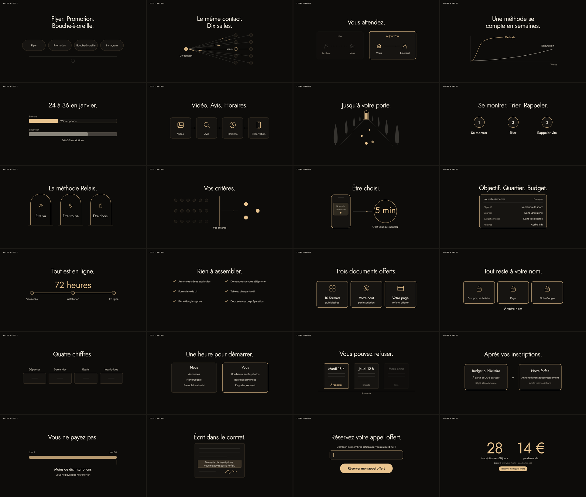

# Animations and diagrams

Motion here explains. It never decorates. Everything is CSS and inline SVG, runs offline, and stays sharp at any size.

## Motion atoms

| Class | Effect | Timing |
| --- | --- | --- |
| `.w` | Each word rises and fades in | .42s, cubic-bezier(.2,.7,.2,1), 26ms stagger capped at 620ms |
| `.slide` | Slide fades in | .3s ease |
| `.in` | Element rises 10px and fades | .6s, same curve |
| `.d1` to `.d6` | Stagger | +.18s per step |
| `.grow` | Bar grows from the left | 1.1s |
| `.draw` | Line draws itself | 1.5s ease-out |
| `.flow` | A dash runs along a path, loops | 3.4s linear |
| `.pulse` | Slow breathing | 3.2s, opacity .35 to 1 |
| `.walk` | Dots walk into the distance, shrinking | 4.2s linear |

Rules:

- Entrances happen once. Only `.flow`, `.pulse` and `.walk` loop, and they stay subtle.
- A diagram reaches its final state in under two seconds.
- **Two-state reveal:** the same diagram on consecutive slides, with more lit on the second. This is the main storytelling device.
- **One accent per diagram state.** Dim what is not being discussed with `on`, `off-g` or `lit`.
- Do not repeat the `key` line inside a diagram.
- About one slide in three carries a diagram. Punchlines and pain stay as text alone.

## The 23 diagrams

Call them with `v('type', ...)`. The build enforces the character limits in `vsl.py`, and `verify.cjs` checks the rendered fit. Icons available: `photo form phone chart person check lock pin eye hand house search grid web coin clock`.



### Show a contrast

| Type | Explains | Parameters (max characters) |
| --- | --- | --- |
| `pills` | The list of old methods, sharing one flaw | `items` 2 to 4 (16), optional `icon` |
| `fanout` | One thing sold or spread to many, with "you" as one of them | `from` (22), `you` (10) |
| `shift` | The direction reversing between then and now | `left` `right` (22), `a` `b` (14), optional `ia` `ib` icons |
| `curves` | Slow asset against fast system. Two states with `two` | `slow` `fast` (18), `axis` (12), `two` |
| `bars` | Two quantities compared. Two states with `two` | `a`: `label` (40) `share` `value` (18). `b`: `label` `share` optional `extra` `value` (40). `two` |

```python
v('pills', items=['Word of mouth', 'Reputation', 'Branding', 'Press'])
v('fanout', **{'from': 'One lead', 'you': 'You'})   # from is a Python keyword
v('shift', left='Then', right='Now', a='The client', b='You')
v('curves', slow='Reputation', fast='System', axis='Time', two=True)
v('bars', a=dict(label='Today', share=.33, value='3 weeks'), b=dict(label='Normally', share=.67, extra=.33, value='6 to 9 weeks'), two=True)
```

`share` is a fraction of the track. `extra` adds a fainter range after it. Above .7, `a.value` moves inside the bar.

### Show how it works

| Type | Explains | Parameters |
| --- | --- | --- |
| `journey` | A sequence of 3 or 4 steps, with flow between them | `steps` `[icon, label (13)]` |
| `road` | Everything leading to your door. The image for a mechanism | none |
| `numbers` | Three moves, numbered | `items` 3 (18) |
| `pillars` | The mechanism's three pillars. `on=0` all, `on=1` to `3` one lit | `items` 3 `[label (11), icon]`, `on` |
| `filter` | Many enter, few pass the criteria | `label` (22) |
| `phone` | A request arriving, and how fast you respond | `notif` 2 (9 each), `big` (6), `caption` (30) |
| `card` | What one incoming request looks like | `title` (30), optional `tag` (12), `rows` 4 `[label (16), value (26)]` |
| `install` | Setup time on a three-point line | `big` (11), `steps` 3 (14) |

```python
v('journey', steps=[['house', 'Project'], ['photo', 'Images'], ['search', 'Google'], ['phone', 'Call']])
v('road')
v('numbers', items=['Show up', 'Filter', 'Call fast'])
v('pillars', items=[['Be seen', 'eye'], ['Be found', 'pin'], ['Be chosen', 'phone']], on=1)
v('filter', label='Your criteria')
v('phone', notif=['New', 'request'], big='5 min', caption='You make the call')
v('card', title='New request', tag='Example', rows=[['Project', 'Home extension'], ['City', 'In your area'], ['Budget', 'Within criteria'], ['Start', 'Within 30 days']])
v('install', big='72 hours', steps=['Your access', 'Setup', 'Live'])
```

Tag any illustrative interface with `Example`.

### Show the offer

| Type | Explains | Parameters |
| --- | --- | --- |
| `stack` | What is included, in two columns. `two=False` shows the first three | `items` 3 to 6 (30), `two` |
| `cards` | Three deliverables or bonuses. `on` lights one | `items` 3 `[icon, title (19), line (24)]`, `on` |
| `owned` | What remains theirs | `items` 3 (19), optional `icon`, `caption` (30) |
| `dashboard` | What they see each week | `items` 4 (13) |
| `split` | Your part and theirs | `left` and `right`: `title` (12), `items` 3 (32) |
| `board` | The picture: choosing among requests. Two states with `lit` | `cards` 3 `[title (13), status (14)]`, `lit`, optional `tag` (12) |

### Show money and risk

| Type | Explains | Parameters |
| --- | --- | --- |
| `twin` | Two separate amounts. `both=False` dims the second | `a` and `b`: `[title (20), line (32), sub (32)]`, `both` |
| `deadline` | A time window and what happens at its end. `tick` marks the end | `start` `end` (12), `title` (44), `sub` (52), `tick` |
| `contract` | The clause, highlighted, signed | `lines` 2 (34) |

### Show the action

| Type | Explains | Parameters |
| --- | --- | --- |
| `cta` | The question and the button | optional `question` (70), `button` (30), defaults from `brand.json` |

## Picking the right one

| You are saying | Use |
| --- | --- |
| "All of these have the same problem" | `pills` |
| "They sell the same thing to ten people" | `fanout` |
| "It used to work this way, now it is the reverse" | `shift` |
| "That takes years, this takes weeks" | `curves` |
| "Here is what your client does before calling" | `journey` |
| "Here is the system" | `road`, then `pillars` |
| "Only the right ones reach you" | `filter`, `card` |
| "You will know right away" | `phone` |
| "Here is everything included" | `stack`, `cards` |
| "It stays yours" | `owned` |
| "Here is your share of the work" | `split` |
| "Two amounts, paid to two parties" | `twin` |
| "If it fails by this date..." | `deadline`, then `contract` |

## Adding a diagram

Only if none of the 23 can say it. Add a function to `VIS` in `player.html` using `T`, `ic`, `V` and the atoms, add its limits to `VISUALS` in `vsl.py`, and draw in the 720 by 240 box. Use tokens only, no hex values. A test fails if the two catalogues differ or a hex color appears in the player.
